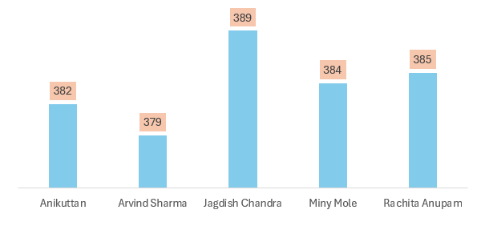
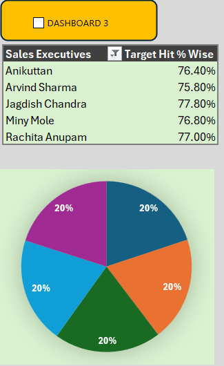
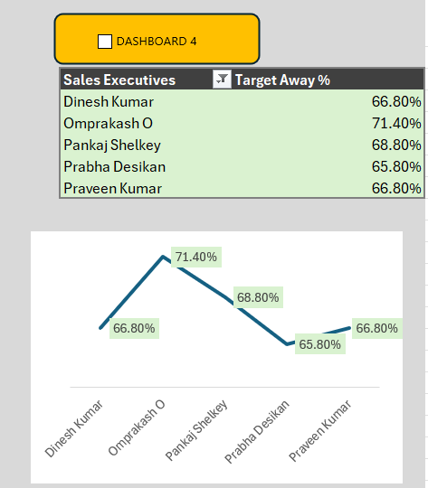

# Sales Performance Dashboard Demo

This is an Excel dashboard I made to track the performance of sales executives.

The dataset has 141 sales executives from different regions. Each person has a daily sales target of 500. I calculated their total sales, target hit percentage, and how far they were from the target.

### What I used
- Microsoft Excel
- Pivot Tables
- Charts
- Basic dashboard layout

### What’s in the dashboard
- Top performers by total sales
- Bottom performers
- Target hit % ranking
- Executives who are farthest from their target

### Some findings
- Highest sales: Jagdish Chandra (389)
- Highest target achievement: also Jagdish Chandra (77.8%)
- Quite a few people are struggling to reach even 40-50% of the target

### Dashboard Screenshots

**Top 5 Sales Executives by Total Sales**  

**Target Hit %**  

**Executives Farthest from Target**  

### How to view it
Just download the Excel file and open the "MY_DASHBOARD" sheet.

File: [EXCEL_WORKSHEET.xlsm](EXCEL_WORKSHEET.xlsm)

---

Rabin Bista  
IT Student | APU Kathmandu
